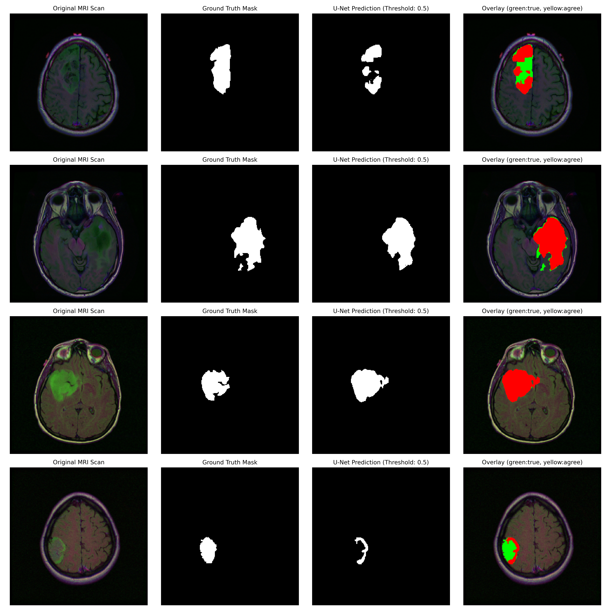
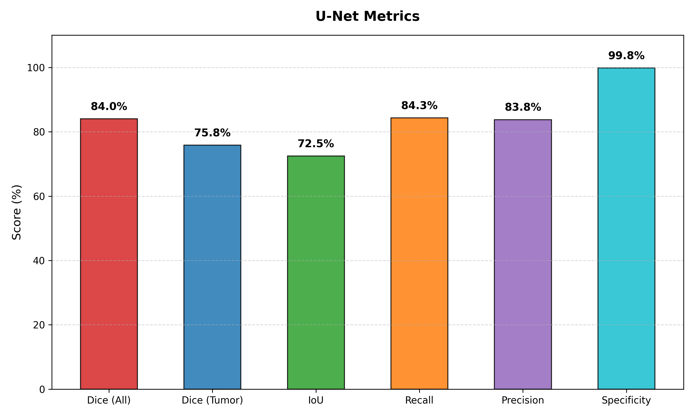

# Brain Tumor Classification, Detection & Segmentation in MRI Scans

This repository provides an end-to-end Deep Learning toolkit for brain tumor analysis from MRI scans. It combines three complementary approaches:
1. **Classification (CNN):** Identifies the type of tumor.
2. **Object Detection (YOLO11):** Locates tumors with bounding boxes.
3. **Semantic Segmentation (U-Net):** Delineates the exact shape and contours of the tumor pixel-by-pixel.

---

## 1. Multi-Class Classification (CNN)

A custom Convolutional Neural Network built in PyTorch to classify brain MRI scans into four categories:
* **Glioma**
* **Meningioma**
* **Pituitary Tumor**
* **No Tumor**

The architecture uses consecutive convolutional layers with Batch Normalization, ReLU activations, Dropout, and fully connected layers for the final prediction.
## 2. Detection (YOLO11)

---

Trained using Ultralytics YOLO11m to detect and draw bounding boxes around detected tumors.
**[View project on Comet ML](https://www.comet.com/hasakij/comet-yolo11-mri)**

---


## 3. Segmentation (U-Net)
### Key Features:
* **Encoder-Decoder Architecture:** Uses skip connections to remember fine boundary details that are usually lost during downsampling.
* **Balanced Loss Function (BCE + Dice):** Brain tumors often small percenage of the total scan area. A hybrid loss with positive class weighting (`pos_weight = 5.0`) prevents the model from ignoring small tumors.
* **Data Augmentation:** Real-time spatial rotations and flips using `Albumentations` prevent overfitting.
* **Hardware Optimized:** Uses Automatic Mixed Precision (AMP FP16)

### U-Net Results & Visual Showcase



*Figure 1: Original MRI scans (FLAIR), true doctor annotations, U-Net predictions, and colored overlays.*



*Figure 2: Clinical evaluation metrics on hold-out validation data.*

| Metric | Score | Explanation |
| :--- | :---: | :--- |
| **Dice Score (All Slices)** | **84.0%** | Overall overlap agreement between AI and doctor annotations |
| **Dice Score (Tumor Only)** | **75.8%** | Accuracy strictly on scans where a tumor is present |
| **IoU (Jaccard Index)** | **72.5%** | Area of overlap divided by area of union |
| **Recall (Sensitivity)** | **84.3%** | How much of the true tumor tissue was detected (low false negative rate) |
| **Precision** | **83.8%** | How confident the model is when it flags an area as tumor |
| **Specificity** | **99.8%** | Accuracy in recognizing healthy brain tissue |
| **MONAI HD95** | **16.5 px** | Boundary contour distance error|

---
## Requirements & Installation

### Main Dependencies
* PyTorch & torchvision (CUDA recommended)
* MONAI (Medical Open Network for AI)
* Albumentations (Data Augmentation)
* Ultralytics (YOLO)
* OpenCV & NumPy
* Matplotlib & Seaborn
* Comet ML

### Setup Instructions

1.  **Clone the repository:**
    ```bash
    git clone https://github.com/YOUR_USERNAME/Brain-Tumor-MRI-Analysis.git
    cd Brain-Tumor-MRI-Analysis
    ```

2.  **(Recommended) Create and activate a virtual environment:**
    For Conda:
    ```bash
    conda create --name mri_env python=3.10
    conda activate mri_env
    ```

3.  **Install PyTorch:**
    This project was developed using PyTorch with **CUDA 12.1**. Please visit the [official PyTorch website](https://pytorch.org/get-started/locally/) to find the installation command that matches your system's hardware (CUDA or CPU).

    The recommended command for a CUDA 12.1 environment is:
    ```bash
    pip install torch torchvision --index-url https://download.pytorch.org/whl/cu121
    ```

4.  **Install other dependencies:**
    Once PyTorch is installed, install the rest of the required packages using the `requirements.txt` file:
    ```bash
    pip install -r requirements.txt
    ```

## Usage

## Run Classification (CNN):
```bash
python train.py
```

## Run Object Detection (YOLO):

Organize the dataset and start YOLO training:
```bash
python organize_data.py
python train_yolo.py
```

## Run Segmentation (U-Net)
```bash
python train_unet.py
```

Evaluate the best model and generate visual prediction plots:
```bash
python evaluate_unet.py
```

## Project Structure
```
Brain-Tumor-MRI-Analysis/
├── README.md           # Project documentation
├── requirements.txt    # Python dependencies
├── LICENSE             # MIT License
|
├── train.py            # Training script for CNN model
├── organize_data.py    # Organizes data for YOLO format
├── train_yolo.py       # Training the YOLO model
│
├── dataset_unet.py           # PyTorch Dataset with Albumentations for MRI
├── unet_model.py             # Custom U-Net architecture from scratch
├── train_unet.py             # Training pipeline with AMP and Early Stopping
├── evaluate_unet.py          # Clinical evaluation with MONAI metrics
│
├── results/                  # Generated comparison plots and metric charts
└── best_unet.pth             # Saved weights of the best U-Net model
```

## License
This project is licensed under the MIT License - see the LICENSE file for details.
